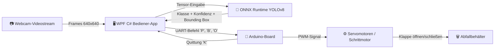

# ♻️ AI Smart Bin — Autonome Abfalltrennstation

<p align="center">
  <a href="README.md"><b>🇬🇧 English</b></a> •
  <a href="README.de.md"><b>🇩🇪 Deutsch</b></a>
</p>

<p align="center">
  
  
  
  
  
  
  
</p>

<p align="center">
  <b>Ein KI-gestütztes Hard- und Softwaresystem zur automatisierten Abfallerkennung, Klassifizierung und getrennten Sammlung.</b><br>
  Entwickelt für schulische und studentische Forschungsprojekte, Umweltmessen und interaktive Vorführungen.
</p>

---

## 📌 Inhaltsverzeichnis
- [🌟 Hauptmerkmale](#-hauptmerkmale)
- [🌐 Mehrsprachige Benutzeroberfläche](#-mehrsprachige-benutzeroberfläche)
- [🏗️ Systemarchitektur](#️-systemarchitektur)
- [🛠️ Technologie-Stack](#️-technologie-stack)
- [📂 Repository-Struktur](#-repository-struktur)
- [⚡ Schnellstart-Anleitung](#-schnellstart-anleitung)
  - [1. Start der WPF-Bedieneranwendung](#1-start-der-wpf-bedieneranwendung)
  - [2. YOLOv8-Training in Google Colab](#2-yolov8-training-in-google-colab)
  - [3. Hochladen der Arduino-Firmware](#3-hochladen-der-arduino-firmware)
- [🔌 Serielles UART-Kommunikationsprotokoll](#-serielles-uart-kommunikationsprotokoll)
- [⚙️ Elektronik-Schaltplan und Aktoren](#️-elektronik-schaltplan-und-aktoren)
- [🎮 Demo-Emulator-Modus (ohne Hardware)](#-demo-emulator-modus-ohne-hardware)
- [👥 Autoren & Mitwirkung](#-autoren--mitwirkung)

---

## 🌟 Hauptmerkmale

* 👁️ **Echtzeit-Abfallerkennung:** Flüssige Videoaufnahme von der Webcam und sofortige Lokalisierung von Objekten mittels **YOLOv8** über **ONNX Runtime**.
* 🎯 **3 Haupt-Abfallkategorien:**
  * 🔵 **Plastik / Wertstoffe** — Flaschen, Becher, Verpackungen, Folien.
  * 🟡 **Papier & Karton** — Schachteln, Kartonagen, Hefte, Zeitungen.
  * 🟢 **Bioabfall / Organisch** — Obstschalen, Apfelgriebsche, Speisereste.
* 🌐 **Vollständige Mehrsprachigkeit:** Die Desktop-App unterstützt **Englisch** und **Deutsch** mit sofortiger Umschaltung im laufenden Betrieb!
* 🤖 **Autonome Aktor-Ansteuerung:** Der Mikrocontroller öffnet die passende Klappe per Servomotor oder dreht das Karussell mit einem Schrittmotor.
* 🛡️ **Fehlauslöseschutz & Cooldown:** Einstellbarer Konfidenz-Schwellenwert (20% bis 95%) und eine 6-Sekunden-Sperre zwischen Öffnungszyklen.
* 📊 **Modernes Cyberpunk-Interface (WPF):** Dunkles Farbschema mit farbigen HUD-Begrenzungsrahmen, Telemetrie-Badges und Ereignisprotokoll.
* 🕹️ **Integrierter Arduino-Emulator:** Vollständige Simulation der Steuersignale (`'P'`, `'B'`, `'O'`, `'K'`) für Präsentationen ohne angeschlossene Hardware.

---

## 🌐 Mehrsprachige Benutzeroberfläche

Die Anwendung verfügt über ein dynamisches Lokalisierungssystem:
* **🇬🇧 English** (Englisch)
* **🇩🇪 Deutsch** (German)

Die Sprache kann jederzeit über das Auswahlfeld oben rechts im Anwendungsfenster gewechselt werden. Alle Fenstertitel, Schaltflächen, Statusanzeigen, Abfallfraktionen und Protokollmeldungen aktualisieren sich ohne Neustart.

---

## 🏗️ Systemarchitektur



---

## 🛠️ Technologie-Stack

| Komponente | Technologie | Zweck |
|---|---|---|
| **Bedieneroberfläche** | C# .NET 8, WPF, XAML, MVVM | Modernes Dashboard, Echtzeit-Telemetrie, Einstellungen und Steuerung |
| **Computer Vision** | `OpenCvSharp4`, `OpenCvSharp4.WpfExtensions` | Webcam-Erfassung im Hintergrundthread und HUD-Zeichnung |
| **KI-Inferenz** | `Microsoft.ML.OnnxRuntime` | Multi-Threaded YOLOv8 ONNX-Ausführung auf der CPU |
| **Modelltraining** | Python, Ultralytics YOLOv8, PyTorch | Cloud-GPU-Training in Google Colab |
| **Serielle Schnittstelle** | `System.IO.Ports` (SerialPort) | Vollduplexe asynchrone UART-Kommunikation (9600 Baud, 8-N-1) |
| **Mikrocontroller** | Arduino Uno / Nano / Mega (C++) | Ansteuerung von Servos (SG90/MG995) oder Schrittmotoren (28BYJ-48) |

---

## 📂 Repository-Struktur

```text
schoolproj_smartaibin/
├── README.md                           # Hauptdokumentation (Englisch)
├── README.de.md                        # Vollständige Dokumentation (Deutsch)
├── COLAB_TRAINING_GUIDE.md             # Schritt-für-Schritt-Anleitung für Google Colab
├── PROJECT_DOCUMENTATION.md            # Technische Spezifikation & Entwickler-Handbuch
├── Train_SmartBin_YOLO.ipynb           # Fertiges Jupyter-Notebook zum Trainieren
├── SmartBin.slnx                       # .NET 8 Solution-Datei für Visual Studio / VS Code
├── ArduinoFirmware/
│   ├── README.md                       # Schaltpläne und Pin-Belegung
│   └── SmartBin_Arduino/
│       └── SmartBin_Arduino.ino        # Firmware-Sketch für Arduino
└── SmartBinApp/                        # WPF C# Desktop-Anwendung
    ├── SmartBinApp.csproj              # Projektdatei (.NET 8 Windows)
    ├── best.onnx                       # Vortrainiertes YOLOv8-ONNX-Modell
    ├── Converters/                     # XAML-Wertekonverter
    ├── Models/                         # Datenmodelle (DetectionResult, LogMessage etc.)
    ├── Services/                       # Lokalisierungs-, Kamera-, KI- und Serial-Dienste
    └── ViewModels/                     # MVVM-ViewModel-Logik
```

---

## ⚡ Schnellstart-Anleitung

### 1. Start der WPF-Bedieneranwendung

#### Voraussetzungen:
* **Windows 10 / 11** (x64)
* **[.NET 8.0 SDK](https://dotnet.microsoft.com/download/dotnet/8.0)**
* Webcam (integriert oder USB)

#### Start per Konsole:
```powershell
cd SmartBinApp
dotnet build
dotnet run
```
*Oder öffnen Sie `SmartBin.slnx` in **Visual Studio 2022** / **VS Code** und drücken Sie `F5`.*

---

### 2. YOLOv8-Training in Google Colab

Im Repository ist bereits ein vortrainiertes Modell [`SmartBinApp/best.onnx`](SmartBinApp/best.onnx) enthalten. Um ein eigenes Modell zu trainieren:
1. Öffnen Sie [Google Colab](https://colab.research.google.com/).
2. Laden Sie das Notebook [`Train_SmartBin_YOLO.ipynb`](Train_SmartBin_YOLO.ipynb) hoch.
3. Wählen Sie als Beschleuniger **T4 GPU** (*Laufzeit ➔ Laufzeittyp ändern*).
4. Führen Sie alle Zellen aus (`Strg + F9`).
5. Nach Abschluss (~10–12 Minuten) wird die Datei `best.onnx` automatisch heruntergeladen.
6. Kopieren Sie `best.onnx` in den Ordner `SmartBinApp/`.

*Ausführliche Details finden Sie in [COLAB_TRAINING_GUIDE.md](COLAB_TRAINING_GUIDE.md).*

---

### 3. Hochladen der Arduino-Firmware

1. Installieren Sie die **[Arduino IDE](https://www.arduino.cc/en/software)**.
2. Öffnen Sie [`ArduinoFirmware/SmartBin_Arduino/SmartBin_Arduino.ino`](ArduinoFirmware/SmartBin_Arduino/SmartBin_Arduino.ino).
3. Schließen Sie Ihr **Arduino Uno** oder **Nano** per USB an.
4. Wählen Sie Board und COM-Port unter *Werkzeuge (Tools)* aus.
5. Klicken Sie auf **Hochladen** (`Strg + U`).

---

## 🔌 Serielles UART-Kommunikationsprotokoll

* **Parameter:** `9600 Baud`, `8-N-1`, `DTR/RTS = true`.

### PC ➔ Arduino:
| Byte | Zielfraktion / Aktion | Beschreibung |
|:---:|---|---|
| `'P'` | **Plastik** | Öffnet die Plastik-Klappe für ca. 2,5 Sek., schließt danach |
| `'B'` | **Papier** | Öffnet die Papier-Klappe für ca. 2,5 Sek., schließt danach |
| `'O'` | **Bioabfall** | Öffnet die Bio-Klappe für ca. 2,5 Sek., schließt danach |
| `'0'` | **Ziel: Alle Motoren** | Wählt alle Motoren für gemeinsame Kalibrierung aus |
| `'1'` | **Ziel: Plastik (D9)** | Wählt den Plastik-Klappenmotor zur Kalibrierung |
| `'2'` | **Ziel: Papier (D10)** | Wählt den Papier-Klappenmotor zur Kalibrierung |
| `'3'` | **Ziel: Bioabfall (D11)** | Wählt den Bio-Klappenmotor zur Kalibrierung |
| `'<'` / `'L'` | **Schritt links / Gegenzeigersinn** | Bewegt gewählten Motor schrittweise nach links (32 Schritte Stepper, -3° Servo) |
| `'>'` / `'R'` | **Schritt rechts / Uhrzeigersinn** | Bewegt gewählten Motor schrittweise nach rechts (32 Schritte Stepper, +3° Servo) |
| `'Z'` | **Nullpunkt setzen** | Speichert aktuelle Position im Arduino-EEPROM als Referenz-Nullpunkt |

### Arduino ➔ PC:
| Antwort | Ereignis | Bedeutung für das Programm |
|:---:|---|---|
| `SMARTBIN_READY\n` | `setup()` beim Start | Bestätigt die Betriebsbereitschaft des Mikrocontrollers |
| `'K'` | Motorzyklus beendet | Bewegung beendet, System bereit für den nächsten Befehl |

---

## ⚙️ Elektronik-Schaltplan und Aktoren

### Standardkonfiguration mit 3 Servomotoren:
* **Servo Plastik:** Signal ➔ Pin **D9**
* **Servo Papier:** Signal ➔ Pin **D10**
* **Servo Bioabfall:** Signal ➔ Pin **D11**
* **Stromversorgung:** Externe geregelte **+5V (2A)** Stromquelle. **GND zwingend mit Arduino verbinden!**

> ⚠️ *Wichtig: Versorgen Sie 3 Servomotoren niemals direkt über den 5V-Pin des Arduino-Boards, um Spannungsabfälle und Neustarts des Controllers zu verhindern.*

*Schaltpläne für Schrittmotoren (28BYJ-48 mit ULN2003-Treiber) finden Sie in [ArduinoFirmware/README.md](ArduinoFirmware/README.md).*

---

## 🎮 Demo-Emulator-Modus (ohne Hardware)

Sie können die gesamte Funktionalität auch ohne ein angeschlossenes Arduino-Board demonstrieren:
1. Starten Sie **SmartBinApp**.
2. Aktivieren Sie das Kontrollkästchen **"Demo-Modus (Arduino-Emulator)"**.
3. Klicken Sie auf **"Kamera starten"** und aktivieren Sie **"Automatische Sortierung"**.
4. Halten Sie Gegenstände vor die Kamera — die KI erkennt die Kategorie, simuliert die serielle Übertragung und protokolliert die virtuellen Servobewegungen!

---

## 👥 Autoren & Mitwirkung

Entwickelt im Rahmen eines schulischen Forschungsprojekts über KI-gestützte Umwelttechnologien.

* **Projekt-Autor:** [@morb1X](https://github.com/morb1X)
* Fragen, Feedback und Fehlerberichte sind im Bereich **[Issues](https://github.com/morb1X/schoolproj_smartaibin/issues)** herzlich willkommen!

⭐ Wenn Ihnen dieses Projekt gefällt, hinterlassen Sie gerne einen Stern im Repository!
