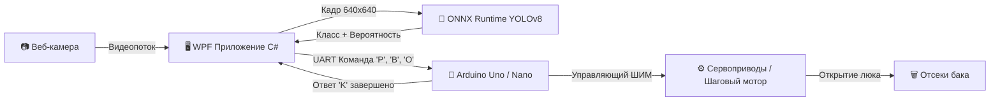

# ♻️ AI Smart Bin — Умная станция раздельного сбора отходов

<p align="center">
  
  
  
  
  
  
</p>

<p align="center">
  <b>Аппаратно-программный комплекс с искусственным интеллектом для автоматизированной сортировки и раздельного сбора отходов.</b><br>
  Разработан для школьных и студенческих экологических проектов, выставок и интерактивных демонстраций.
</p>

---

## 📌 Содержание
- [🌟 Ключевые возможности](#-ключевые-возможности)
- [🏗️ Архитектура системы](#️-архитектура-системы)
- [🛠️ Технологический стек](#️-технологический-стек)
- [📂 Структура репозитория](#-структура-репозитория)
- [⚡ Быстрый старт](#-быстрый-старт)
  - [1. Запуск приложения оператора (WPF)](#1-запуск-приложения-оператора-wpf)
  - [2. Обучение модели YOLOv8 в Google Colab](#2-обучение-модели-yolov8-в-google-colab)
  - [3. Прошивка контроллера Arduino](#3-прошивка-контроллера-arduino)
- [🔌 Протокол взаимодействия (UART 9600)](#-протокол-взаимодействия-uart-9600)
- [⚙️ Схема подключения электроники](#️-схема-подключения-электроники)
- [🎮 Демо-режим (Эмулятор без стенда)](#-демо-режим-эмулятор-без-стенда)
- [👥 Авторы и участие в проекте](#-авторы-и-участие-в-проекте)

---

## 🌟 Ключевые возможности

* 👁️ **Распознавание отходов в реальном времени:** захват видеопотока с веб-камеры и мгновенная детекция объектов с помощью нейросети **YOLOv8** (экспортированной в формат ONNX).
* 🎯 **3 основные категории сортировки:**
  * 🔵 **Пластик** (*Plastic*) — бутылки, пластиковые стаканчики, упаковка.
  * 🟡 **Бумага и картон** (*Paper*) — листы, коробки, тетради.
  * 🟢 **Органика** (*Organic*) — пищевые отходы, фрукты, кожура.
* 🤖 **Аппаратная интеграция с Arduino:** автоматическое открытие нужного люка бака сервоприводами или поворот карусели шаговым двигателем.
* 📊 **Современный UI в тёмной теме:** информативная панель оператора на WPF с отображением видео с цветными ограничивающими рамками (Bounding Boxes), бейджами статуса и журналом событий.
* 🛡️ **Защита от ложных срабатываний:** настраиваемый порог уверенности (Confidence Threshold) и кулдаун (cooldown) между открытиями люков.
* 🕹️ **Встроенный демо-режим:** возможность полноценного тестирования и демонстрации работы ИИ без подключённого физического стенда.

---

## 🏗️ Архитектура системы



---

## 🛠️ Технологический стек

| Компонент | Технологии | Описание |
|---|---|---|
| **Клиент оператора** | C# .NET 8, WPF, XAML, MVVM | Графический интерфейс оператора с журналом событий и управлением периферией |
| **Компьютерное зрение** | `OpenCvSharp4`, `OpenCvSharp4.WpfExtensions` | Захват видео с USB/встроенной камеры в отдельном фоновом потоке, отрисовка рамок |
| **Инференс нейросети** | `Microsoft.ML.OnnxRuntime` | Высокопроизводительный запуск модели YOLOv8 на CPU/GPU |
| **Обучение модели** | Python, Ultralytics YOLOv8, PyTorch | Обучение модели детекции мусора в облаке Google Colab |
| **Связь с микроконтроллером** | `System.IO.Ports` (SerialPort) | Полнодуплексный асинхронный протокол по COM-порту (UART 9600 бод) |
| **Микроконтроллер** | Arduino C++ (Uno / Nano / Mega) | Управление сервоприводами SG90/MG995 или шаговым двигателем 28BYJ-48 с ULN2003 |

---

## 📂 Структура репозитория

```text
schoolproj_smartaibin/
├── README.md                           # Главное описание проекта
├── PROJECT_INSTRUCTIONS.md             # Полное руководство, спецификации и журнал разработки
├── ИНСТРУКЦИЯ_ОБУЧЕНИЯ_COLAB.md        # Пошаговая инструкция по обучению в Google Colab
├── Train_SmartBin_YOLO.ipynb           # Jupyter-блокнот для обучения нейросети
├── SmartBin.slnx                       # Файл решения (Solution) .NET 8
├── ArduinoFirmware/
│   ├── README.md                       # Схемы подключения и распиновка моторов
│   └── SmartBin_Arduino/
│       └── SmartBin_Arduino.ino        # Исходный код прошивки микроконтроллера Arduino
└── SmartBinApp/                        # Десктопное приложение оператора (WPF)
    ├── SmartBinApp.csproj              # Проект C# .NET 8 WPF
    ├── best.onnx                       # Обученная модель детекции YOLOv8
    ├── Converters/                     # Конвертеры данных XAML
    ├── Models/                         # Модели детекции, логов и устройств
    ├── Services/                       # Сервисы камеры (OpenCV), ИИ (ONNX) и Serial UART
    └── ViewModels/                     # Бизнес-логика интерфейса (MVVM)
```

---

## ⚡ Быстрый старт

### 1. Запуск приложения оператора (WPF)

#### Требования:
* ОС: **Windows 10 / 11** (x64)
* Установленный **[.NET 8.0 SDK](https://dotnet.microsoft.com/download/dotnet/8.0)**
* Веб-камера (встроенная или внешняя USB)

#### Запуск из терминала:
```powershell
# Перейдите в папку приложения
cd SmartBinApp

# Соберите и запустите проект
dotnet build
dotnet run
```
*Или откройте `SmartBin.slnx` в **Visual Studio 2022** / **VS Code** и нажмите `F5`.*

---

### 2. Обучение модели YOLOv8 в Google Colab

В репозитории уже есть готовая обученная модель [`SmartBinApp/best.onnx`](SmartBinApp/best.onnx), но при желании вы можете дообучить или обучить собственную модель:

1. Откройте [Google Colab](https://colab.research.google.com/).
2. Загрузите файл блокнота [`Train_SmartBin_YOLO.ipynb`](Train_SmartBin_YOLO.ipynb).
3. В меню выберите: **Среда выполнения ➔ Сменить тип среды выполнения ➔ T4 GPU**.
4. Нажмите **Среда выполнения ➔ Выполнить всё** (`Ctrl + F9`).
5. После завершения обучения файл `best.onnx` автоматически скачается в браузер.
6. Скопируйте `best.onnx` в папку `SmartBinApp/`.

*Подробный разбор шагов смотрите в файле [ИНСТРУКЦИЯ_ОБУЧЕНИЯ_COLAB.md](ИНСТРУКЦИЯ_ОБУЧЕНИЯ_COLAB.md).*

---

### 3. Прошивка контроллера Arduino

1. Установите **[Arduino IDE](https://www.arduino.cc/en/software)**.
2. Откройте файл скетча [`ArduinoFirmware/SmartBin_Arduino/SmartBin_Arduino.ino`](ArduinoFirmware/SmartBin_Arduino/SmartBin_Arduino.ino).
3. Подключите плату **Arduino Uno** или **Nano** по USB.
4. Выберите порт и плату в меню *Инструменты (Tools)*.
5. Нажмите кнопку **«Загрузить» (Upload)** (`Ctrl + U`).

---

## 🔌 Протокол взаимодействия (UART 9600)

* **Параметры соединения:** `9600 baud`, `8-N-1`, `DTR/RTS = true`.

### Команды от ПК к Arduino:
| Байт (ASCII) | Назначение | Действие на стенде |
|:---:|---|---|
| `'P'` | **Пластик** (*Plastic*) | Открыть люк пластика на 3 сек, затем закрыть |
| `'B'` | **Бумага** (*Paper*) | Открыть люк бумаги на 3 сек, затем закрыть |
| `'O'` | **Органика** (*Organic*) | Открыть люк органики на 3 сек, затем закрыть |

### Ответы от Arduino к ПК:
| Ответ | Событие | Значение для приложения |
|:---:|---|---|
| `SMARTBIN_READY\n` | Старт микроконтроллера | Arduino подтверждает готовность к работе |
| `'K'` | Завершение движения люка | Механизм закрыт, система готова к следующему предмету |

---

## ⚙️ Схема подключения электроники

### Вариант с 3 сервоприводами (по умолчанию):
* **Сервопривод пластика:** Сигнал ➔ Пин **D9**
* **Сервопривод бумаги:** Сигнал ➔ Пин **D10**
* **Сервопривод органики:** Сигнал ➔ Пин **D11**
* **Питание сервоприводов:** Внешний блок питания **+5V (2А)**, общая земля **GND** с платой Arduino.

> ⚠️ *Внимание: Не питайте мощные сервоприводы напрямую от выхода 5V платы Arduino во избежание просадок напряжения и перезагрузки платы.*

*Схему для шагового двигателя 28BYJ-48 с драйвером ULN2003 смотрите в [ArduinoFirmware/README.md](ArduinoFirmware/README.md).*

---

## 🎮 Демо-режим (Эмулятор без стенда)

Если у вас под рукой нет физической платы Arduino:
1. Запустите приложение **SmartBinApp**.
2. В блоке подключения активируйте переключатель **«Демо-режим (эмулятор)»**.
3. Нажмите **«Запустить камеру»** и включите **«Автоматическая сортировка»**.
4. Показывайте предметы камере — приложение выполнит детекцию, сымитирует отправку команд и виртуальное открытие люков с записями в журнале событий!

---

## 👥 Авторы и участие в проекте

Проект разработан в рамках школьной исследовательской инициативы по экологии и искусственному интеллекту.

* **Автор проекта:** [@morb1X](https://github.com/morb1X)
* Вопросы, предложения и баг-репорты приветствуются в разделе **[Issues](https://github.com/morb1X/schoolproj_smartaibin/issues)**!

⭐ Если проект вам понравился, не забудьте поставить звёздочку репозиторию!
