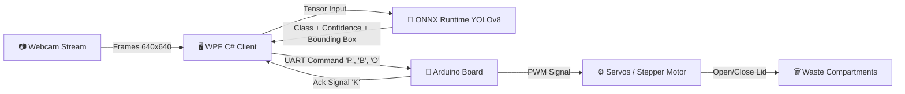

# ♻️ AI Smart Bin — Autonomous Waste Sorting Station

<p align="center">
  <a href="README.md"><b>🇬🇧 English</b></a> •
  <a href="README.de.md"><b>🇩🇪 Deutsch</b></a>
</p>

<p align="center">
  
  
  
  
  
  
  
</p>

<p align="center">
  <b>An AI-powered hardware-software system for automated waste recognition, classification, and separate collection.</b><br>
  Built for school and student science fairs, environmental exhibitions, and interactive demonstrations.
</p>

---

## 📌 Table of Contents
- [🌟 Key Features](#-key-features)
- [🌐 Multi-Language Support](#-multi-language-support)
- [🏗️ System Architecture](#️-system-architecture)
- [🛠️ Technology Stack](#️-technology-stack)
- [📂 Repository Structure](#-repository-structure)
- [⚡ Quick Start Guide](#-quick-start-guide)
  - [1. Launching the Operator WPF Client](#1-launching-the-operator-wpf-client)
  - [2. Training YOLOv8 in Google Colab](#2-training-yolov8-in-google-colab)
  - [3. Uploading Firmware to Arduino](#3-uploading-firmware-to-arduino)
- [🔌 Serial UART Communication Protocol](#-serial-uart-communication-protocol)
- [⚙️ Hardware Wiring & Actuators](#️-hardware-wiring--actuators)
- [🎮 Demo Emulator Mode (No Hardware Needed)](#-demo-emulator-mode-no-hardware-needed)
- [👥 Authors & Contributing](#-authors--contributing)

---

## 🌟 Key Features

* 👁️ **Real-time Waste Vision:** High-fps webcam video capture and instant item localization using **YOLOv8** running on **ONNX Runtime**.
* 🎯 **3 Core Sorting Fractions:**
  * 🔵 **Plastic** — bottles, cups, food packaging, wrappers, foil.
  * 🟡 **Paper & Cardboard** — cartons, notebooks, newspapers, office paper.
  * 🟢 **Organic / Bio-waste** — fruit peels, apple cores, food leftovers.
* 🌐 **Full Multi-Language Support:** The operator desktop app supports **English** and **German** with instant in-app switching!
* 🤖 **Autonomous Actuator Triggering:** Microcontroller automatically opens the designated compartment lid via servos or rotates a carousel using a stepper motor.
* 🛡️ **Anti-Flicker & Safety Cooldown:** Configurable confidence threshold (20% to 95%) and a 6-second cooldown between trigger cycles to prevent redundant actuation.
* 📊 **Modern Cyberpunk UI (WPF):** Dark mode theme with colored HUD bounding boxes, telemetry status badges, and event logs.
* 🕹️ **Built-in Arduino Emulator:** Complete simulation of hardware signals (`'P'`, `'B'`, `'O'`, `'K'`) for presentations and testing without physical boards.

---

## 🌐 Multi-Language Support

The application includes real-time dynamic localization:
* **🇬🇧 English** (Default)
* **🇩🇪 Deutsch** (German)

Switch languages at any time using the selector in the top-right corner of the application window. All titles, buttons, status badges, waste categories, and event logs update immediately.

---

## 🏗️ System Architecture



---

## 🛠️ Technology Stack

| Component | Technology | Role |
|---|---|---|
| **Operator GUI** | C# .NET 8, WPF, XAML, MVVM | Operator dashboard, real-time telemetry, settings, and controls |
| **Computer Vision** | `OpenCvSharp4`, `OpenCvSharp4.WpfExtensions` | Low-latency camera capture on background thread and HUD rendering |
| **Neural Network Inference** | `Microsoft.ML.OnnxRuntime` | Multi-threaded YOLOv8 execution on CPU |
| **AI Training Pipeline** | Python, Ultralytics YOLOv8, PyTorch | Cloud GPU training in Google Colab |
| **Serial Communication** | `System.IO.Ports` (SerialPort) | Full-duplex asynchronous UART communication (9600 baud, 8-N-1) |
| **Hardware Controller** | Arduino Uno / Nano / Mega (C++) | Servo lid actuation (SG90/MG995) or stepper motor control (28BYJ-48) |

---

## 📂 Repository Structure

```text
schoolproj_smartaibin/
├── README.md                           # Main English documentation
├── README.de.md                        # German documentation
├── COLAB_TRAINING_GUIDE.md             # Guide for training YOLOv8 in Google Colab
├── PROJECT_DOCUMENTATION.md            # Technical specifications and developer reference
├── Train_SmartBin_YOLO.ipynb           # Ready-to-run Jupyter training notebook
├── SmartBin.slnx                       # .NET 8 Visual Studio / VS Code solution
├── ArduinoFirmware/
│   ├── README.md                       # Electrical wiring schematics and pinout
│   └── SmartBin_Arduino/
│       └── SmartBin_Arduino.ino        # Microcontroller firmware sketch
└── SmartBinApp/                        # WPF C# Desktop Application
    ├── SmartBinApp.csproj              # Project file (.NET 8 Windows)
    ├── best.onnx                       # Pre-trained YOLOv8 ONNX model
    ├── Converters/                     # XAML UI value converters
    ├── Models/                         # Data models (DetectionResult, LogMessage, etc.)
    ├── Services/                       # Localization, camera, detector, and serial services
    └── ViewModels/                     # MVVM ViewModel logic
```

---

## ⚡ Quick Start Guide

### 1. Launching the Operator WPF Client

#### Prerequisites:
* **Windows 10 / 11** (x64)
* **[.NET 8.0 SDK](https://dotnet.microsoft.com/download/dotnet/8.0)**
* Webcam (internal or USB)

#### Run via CLI:
```powershell
cd SmartBinApp
dotnet build
dotnet run
```
*Or open `SmartBin.slnx` in **Visual Studio 2022** / **VS Code** and press `F5`.*

---

### 2. Training YOLOv8 in Google Colab

The repository includes a ready-to-use model [`SmartBinApp/best.onnx`](SmartBinApp/best.onnx). To train your own model:
1. Open [Google Colab](https://colab.research.google.com/).
2. Upload [`Train_SmartBin_YOLO.ipynb`](Train_SmartBin_YOLO.ipynb).
3. Set runtime to **T4 GPU** (*Runtime ➔ Change runtime type*).
4. Run all cells (`Ctrl + F9`).
5. The trained `best.onnx` will download automatically upon completion (~10–12 minutes).
6. Place `best.onnx` into `SmartBinApp/`.

*See the detailed guide in [COLAB_TRAINING_GUIDE.md](COLAB_TRAINING_GUIDE.md).*

---

### 3. Uploading Firmware to Arduino

1. Install **[Arduino IDE](https://www.arduino.cc/en/software)**.
2. Open [`ArduinoFirmware/SmartBin_Arduino/SmartBin_Arduino.ino`](ArduinoFirmware/SmartBin_Arduino/SmartBin_Arduino.ino).
3. Connect your **Arduino Uno** or **Nano** via USB.
4. Select the board and COM port in *Tools*.
5. Click **Upload** (`Ctrl + U`).

---

## 🔌 Serial UART Communication Protocol

* **Parameters:** `9600 baud`, `8-N-1`, `DTR/RTS = true`.

### PC ➔ Arduino:
| Byte | Target Fraction / Action | Description |
|:---:|---|---|
| `'P'` | **Plastic** | Opens plastic compartment lid for ~2.5 sec, then closes |
| `'B'` | **Paper** | Opens paper compartment lid for ~2.5 sec, then closes |
| `'O'` | **Organic** | Opens organic compartment lid for ~2.5 sec, then closes |
| `'<'` / `'L'` | **Nudge Left / CCW** | Manually moves motor left (32 steps for stepper, -3° for servo) |
| `'>'` / `'R'` | **Nudge Right / CW** | Manually moves motor right (32 steps for stepper, +3° for servo) |
| `'Z'` | **Set Home / Zero** | Saves current physical position to Arduino EEPROM as the reference zero |

### Arduino ➔ PC:
| Response | Trigger | Description |
|:---:|---|---|
| `SMARTBIN_READY\n` | `setup()` boot | Notifies PC that microcontroller is initialized and ready |
| `'K'` | Motor completion | Movement finished, hardware ready for the next command |

---

## ⚙️ Hardware Wiring & Actuators

### 3-Servo Configuration (Default):
* **Plastic Servo:** Signal ➔ Pin **D9**
* **Paper Servo:** Signal ➔ Pin **D10**
* **Organic Servo:** Signal ➔ Pin **D11**
* **Power Supply:** External regulated **+5V (2A)** power supply. **Share GND with Arduino!**

> ⚠️ *Important: Never power 3 servos directly from the Arduino 5V pin. Use external 5V power to prevent microcontroller brownouts.*

*For stepper motor wiring (28BYJ-48 with ULN2003 driver), see [ArduinoFirmware/README.md](ArduinoFirmware/README.md).*

---

## 🎮 Demo Emulator Mode (No Hardware Needed)

You can run and test the complete system without an Arduino board:
1. Start **SmartBinApp**.
2. Check the **"Demo Mode (Arduino Emulator)"** box.
3. Click **"Start Camera"** and enable **"Automatic Sorting"**.
4. Hold items up to the camera — the AI will detect the category, simulate UART transmission, and log virtual servo movements!

---

## 👥 Authors & Contributing

Developed as part of a school research project on environmental AI applications.

* **Project Author:** [@morb1X](https://github.com/morb1X)
* Issues, feedback, and pull requests are welcome in **[Issues](https://github.com/morb1X/schoolproj_smartaibin/issues)**!

⭐ If you find this project useful, please consider giving it a star!
